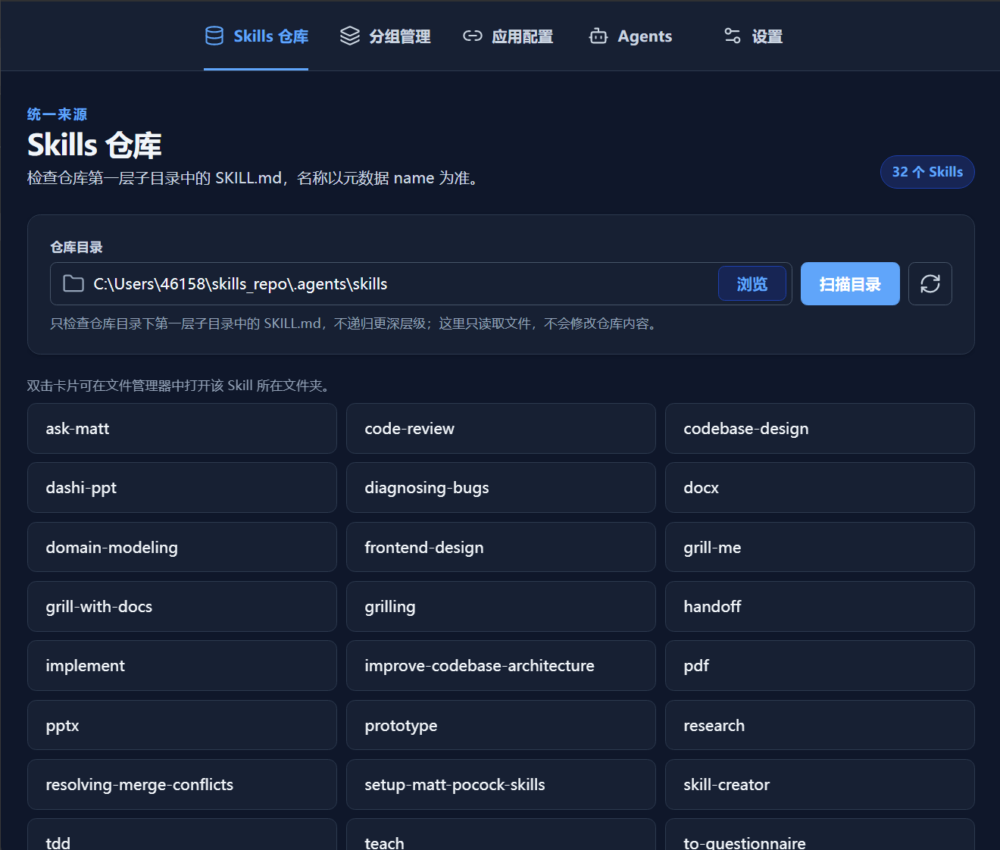
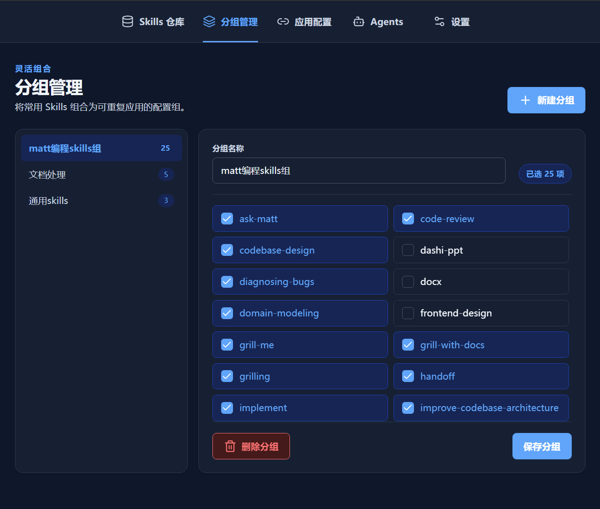
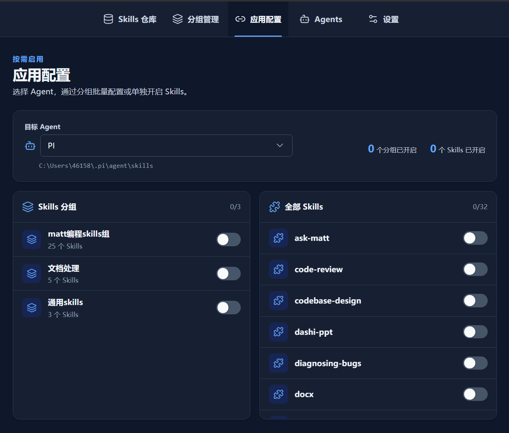
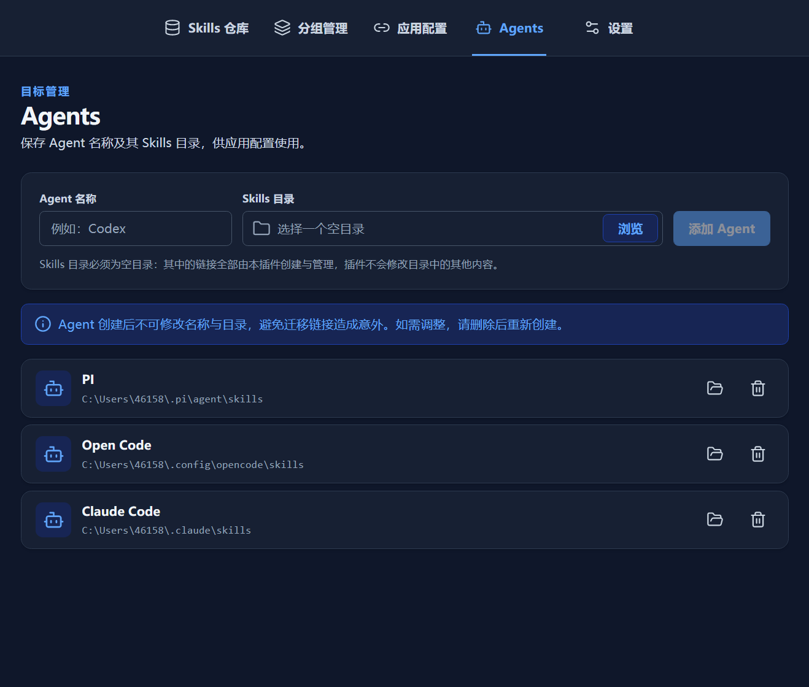
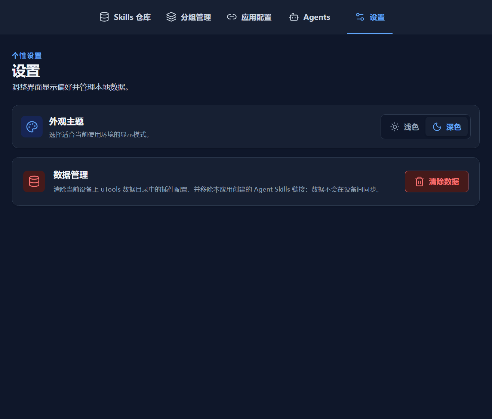

# Skills 管理器（uTools 插件）

一个轻量、安全的 [uTools](https://www.u-tools.cn/) 插件，用于将本地**统一 Skills 仓库**中的各类 AI Agent Skills 按需分发到多个 Agent 目录（如 Claude Code、Codex、OpenCode、Pi 等）。

插件支持 **链接形式** 与 **直接复制** 两种同步方式，提供分组批量开关、冲突保护与防误删校验，且**始终只读统一仓库，绝不修改仓库源文件**。

---

## 核心功能

- **统一 Skills 仓库扫描**：只读扫描仓库第一层子目录中的 `SKILL.md`（大小写不敏感），以 YAML 元数据的 `name` 作为界面展示名，双击卡片即可在系统文件管理器中打开对应 Skill 文件夹。
- **灵活分组管理**：将常用 Skills 组合为可复用的配置组，在应用配置页一键批量开启或关闭；分组只是选择模板，增删分组不会破坏已有配置。
- **多 Agent 目标管理**：保存多个 Agent 的名称与 Skills 目录（允许目录中已有其他文件），支持一键打开目录；创建时单选配置方式（**链接形式** / **直接复制**），创建后不可修改，防止迁移误操作。
- **双同步模式与防误删机制**：
  - **链接形式（默认）**：在 Agent 目录创建指向仓库的目录符号链接（Windows 使用 junction），仓库更新实时同步、不占额外空间。
  - **直接复制**：开启时通过同目录暂存 + 原子改名复制完整 Skill 目录树；目标已有同名项时绝不覆盖，按单 Skill 粒度回退开关；关闭、刷新或清理前会严格校验目标为真实目录、顶层含 `SKILL.md` 且内容与原 Skill / 复制快照一致，防止误删用户内容。
- **轻量交互体验**：开关采用「乐观更新 + 300ms 防抖合并 + 失败回滚」；内置浅色 / 深色双主题；本地配置原子写入 `<uTools userData>/skills-manager/state.json`，仅本机存储。

---

## 两种同步方式对比

| 维度 | 链接形式（默认） | 直接复制 |
| --- | --- | --- |
| 同步原理 | 创建指向仓库子目录的符号链接 / junction | 复制完整 Skill 目录树到 Agent 目录，并在本地记录 SHA-256 快照指纹 |
| 仓库更新同步 | 实时生效，无需重新复制 | 点击「重新扫描」时，未修改的副本自动安全更新；已被本地修改的副本保留并提示 |
| 目标同名冲突 | 保留原内容不覆盖，并提示冲突 | 保留原内容不覆盖，**按单 Skill 粒度回退添加**（开关弹回“关”）并弹出提示 |
| 删除 / 清理保护 | 仅删除目标指向当前仓库内的符号链接；普通文件、目录及外部链接一律不动 | 仅清理本插件记录的副本，删前必查顶层 `SKILL.md` 与完整目录树指纹一致（忽略 `Thumbs.db` / `desktop.ini` / `.DS_Store`）；不一致或未记录的目录一律保留 |
| 适用场景 | 大多数支持符号链接的本地 Agent（推荐） | 不识别符号链接或需要独立文件副本的 Agent / 沙箱环境 |

---

## 界面预览

| Skills 仓库 | 分组管理 |
| --- | --- |
|  |  |

| 应用配置 | Agents 管理 |
| --- | --- |
|  |  |

| 个性设置与数据管理 |
| --- |
|  |

---

## 使用流程

1. **配置 Skills 仓库**：在「Skills 仓库」页选择存放所有 Skills 的根目录并点击「扫描目录」。仓库结构约定如下：
   ```text
   skills-repo/
   ├── code-review/
   │   ├── SKILL.md      # 顶层 YAML frontmatter 需包含 name 字段
   │   └── ...
   └── frontend-design/
       └── SKILL.md
   ```
2. **（可选）创建分组**：在「分组管理」页将常用 Skills 编组保存，便于跨 Agent 复用。
3. **添加 Agent**：在「Agents」页填写名称与目标 Skills 目录，点击「添加 Agent」并在弹出的「额外配置」对话框中选择「链接形式」或「直接复制」。
4. **按需启用**：在「应用配置」页选择目标 Agent，通过分组或单个 Skill 开关即时同步。

---

## 安全防护设计

- **只读仓库**：插件对统一 Skills 仓库只执行读取与扫描，任何写操作均限定在目标 Agent 目录与本地配置文件。
- **不完整扫描与空仓库防护**：当仓库中出现无法读取或元数据损坏的 `SKILL.md`（`complete = false`），或原本有数据的仓库突然扫出为空时，插件会暂停清理并保留现有启用记录、链接与副本；空仓库需用户在界面显式点击「确认仓库已清空」后才收敛。
- **路径安全校验**：禁止将磁盘根目录设为仓库或 Agent 目录，禁止仓库与 Agent 目录相同或互相包含，所有路径比较均经 `realpath` 与跨平台词法规范化处理。
- **配置文件原子写入**：`state.json` 采用「同目录临时文件 + `fsync` + 原子重命名」写入，避免异常中断导致配置截断。

更多详细预期行为与异常边界见 [doc/用户操作与异常场景.md](doc/用户操作与异常场景.md)。

---

## 本地开发与测试

### 技术栈

- **前端渲染层**：Vue 3 + Pinia + Vue Router（`createMemoryHistory`）+ Tailwind CSS v4 + `@lucide/vue` + Vite
- **本地能力层**：uTools Preload（Node.js / CommonJS）

### 环境要求

- Node.js 18+
- pnpm
- [uTools](https://www.u-tools.cn/) 与「uTools 开发者工具」插件

### 常用命令

```bash
# 安装依赖
pnpm install

# 启动 Vite 开发服务器（固定端口 127.0.0.1:5173，供 uTools 开发模式加载）
pnpm dev

# 构建插件产物到 dist/（改动 src/ 或 public/ 后需重新构建）
pnpm build

# 运行全量自动化回归测试（纯 Node 脚本，无需测试框架）
node test_dir/test/run-all.cjs

# 运行单个测试模块示例
node test_dir/test/09-copy-mode.cjs
```

> **提示**：直接在浏览器访问 `http://127.0.0.1:5173` 仅能预览前端 UI（无 `window.skillsManager`，会走降级分支）；完整本地文件与链接/复制能力需在 **uTools 开发者工具** 中加载 `dist/plugin.json`（或开启开发模式）测试。

---

## 项目结构

```text
skills-manager/
├── doc/
│   ├── image/                     # 界面截图
│   └── 用户操作与异常场景.md       # 全量行为规范、安全红线与测试清单
├── public/
│   ├── logo.png                   # 插件图标
│   ├── plugin.json                # uTools 插件清单
│   └── preload/                   # uTools Node/CommonJS 预加载层
│       ├── package.json           # 锁定 CommonJS 模块类型
│       ├── services.js            # preload 入口（挂载 window.skillsManager）
│       ├── api.js                 # 业务编排与写操作串行队列
│       ├── config.js              # 本地 state.json 原子读写与规范化
│       ├── scanner.js             # 仓库第一层 SKILL.md 扫描与解析
│       ├── links.js               # 链接形式同步与清理
│       ├── copies.js              # 直接复制同步、树指纹校验与清理
│       └── utils.js               # 路径比较、目录规范化与超时工具
├── src/                           # Vue 3 渲染层（ESM）
│   ├── api/backend.js             # 访问 window.skillsManager 的唯一入口
│   ├── components/                # 通用组件（弹窗、徽标、选择器、开关等）
│   ├── composables/               # 分组编辑草稿状态机
│   ├── router/                    # 内存路由与导航派生
│   ├── stores/                    # Pinia 状态、反馈中心与开关防抖队列
│   ├── types/skills-manager.d.ts  # 渲染层与 preload 契约类型定义
│   ├── views/                     # 5 个主页面视图
│   ├── App.vue
│   └── main.css                   # Tailwind v4 主题语义令牌
├── test_dir/                      # 纯 Node 自动化测试套件与沙箱目录
├── AGENTS.md                      # AI 协作者开发指南与约束
├── package.json
└── vite.config.js
```

---

## 相关文档

- [用户操作与异常场景.md](doc/用户操作与异常场景.md)：按用户视角整理的全部场景、安全红线、已知取舍与自动化测试编号映射。
- [AGENTS.md](AGENTS.md)：项目架构约束、开发约定与验证流程。
